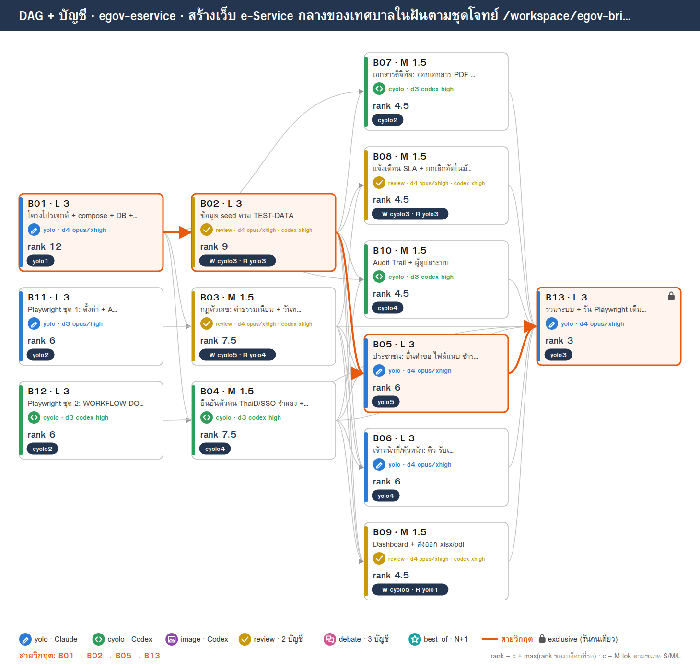
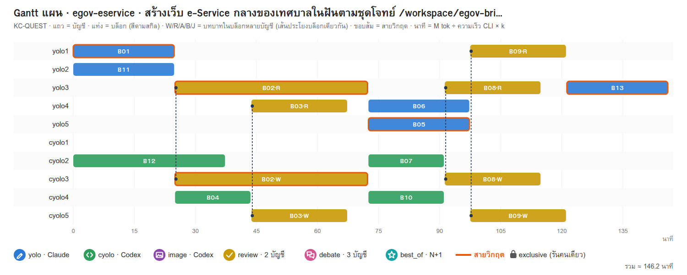

# PLAN · egov-eservice

**เป้าหมาย:** สร้างเว็บ e-Service กลางของเทศบาลในฝันตามชุดโจทย์ /workspace/egov-brief ให้ตรง REQUIREMENTS CONTRACT TEST-DATA DECISIONS ครบทุกข้อ รันด้วย Docker Compose คำสั่งเดียว รองรับ TEST_MODE=1 และ BUG_MODE (B01–B12 ตาม BUGS.md) พร้อมชุด Playwright ครบ 51 TC ใน TEST-PLAN.md

วางแผนเมื่อ 2026-11-21 13:47 · โควตา: **จริงจาก team.py check/quota** · max agents 4 · k ที่ใช้: ยังไม่มี (k = 1)

> แผนนี้ยังไม่ได้รันจริง · เวลาเป็นการประมาณด้วย KC-QUEST (M tok ÷ ความเร็ว CLI × k)

## 1) บัญชีและโควตา

| บัญชี | ฝั่ง | check | ใช้ไป 5 ชม. % | ใช้ไปสัปดาห์ % | เหลือ (5ชม./สัปดาห์) | slot | ชม.ถึงรีเซ็ตสัปดาห์ | เวลาของข้อมูล | หมายเหตุ |
|---|---|---|---|---|---|---|---|---|---|
| yolo1 | yolo | ready | 18 | 3 | 82 / 97 | 3 | 167 | 2026-11-21 13:47:36 | โควตาจริง (team.py quota) · รีเซ็ตสัปดาห์จาก /usage |
| yolo2 | yolo | ready | 18 | 3 | 82 / 97 | 3 | 167 | 2026-11-21 13:47:39 | โควตาจริง (team.py quota) · รีเซ็ตสัปดาห์จาก /usage |
| yolo3 | yolo | ready | 18 | 3 | 82 / 97 | 3 | 167 | 2026-11-21 13:47:43 | โควตาจริง (team.py quota) · รีเซ็ตสัปดาห์จาก /usage |
| yolo4 | yolo | ready | 18 | 3 | 82 / 97 | 3 | 167 | 2026-11-21 13:47:48 | โควตาจริง (team.py quota) · รีเซ็ตสัปดาห์จาก /usage |
| yolo5 | yolo | ready | 18 | 3 | 82 / 97 | 3 | 167 | 2026-11-21 13:47:51 | โควตาจริง (team.py quota) · รีเซ็ตสัปดาห์จาก /usage |
| cyolo1 | cyolo | ready | 1 | 0 | 99 / 100 | 3 | 115 | 2026-11-19 09:03:15 | โควตาจริง (team.py quota) · รีเซ็ตสัปดาห์จาก rate_limits |
| cyolo2 | cyolo | ready | 9 | 1 | 91 / 99 | 3 | 1 | 2026-11-11 23:38:18 | โควตาจริง (team.py quota) · รีเซ็ตสัปดาห์จาก rate_limits |
| cyolo3 | cyolo | ready | 11 | 2 | 89 / 98 | 3 | 1 | 2026-11-11 23:39:46 | โควตาจริง (team.py quota) · รีเซ็ตสัปดาห์จาก rate_limits |
| cyolo4 | cyolo | ready | 13 | 2 | 87 / 98 | 3 | 1 | 2026-11-11 23:41:25 | โควตาจริง (team.py quota) · รีเซ็ตสัปดาห์จาก rate_limits |
| cyolo5 | cyolo | ready | 16 | 2 | 84 / 98 | 3 | 1 | 2026-11-11 23:43:07 | โควตาจริง (team.py quota) · รีเซ็ตสัปดาห์จาก rate_limits |

## 2) DAG (rank · สายวิกฤต · สกิล · บัญชี)

**สายวิกฤต:** B01 → B02 → B05 → B13

## 3) ตารางแจกงาน

| บล็อก | ชื่อ | สกิล | รุ่น/effort | ขนาด·c | ต้องรอ | rank | บัญชี (บทบาท) | เริ่ม–จบ (นาที) | เหตุผล KC-QUEST |
|---|---|---|---|---|---|---|---|---|---|
| **B01** | โครงโปรเจกต์ + compose + DB + test hook | yolo | d4 opus/xhigh | L·3 | - | 12 | yolo1 | 0.0–25.0 | KC-QUEST 31.4 (U=0.126 F=0.01 S=0.742 S=1.0 L=0.0) · 3.00M tok ≈ 5ชม. 7.8% / สัปดาห์ 0.98% · cap 30.15 · อันดับ 2 yolo2 31.4 |
| B11 | Playwright ชุด 1: ตั้งค่า + AUTH FEE SUBMIT UPLOAD PAY QUEUE SLA NOTI | yolo | d3 opus/high | L·3 | - | 6 | yolo2 | 0.0–25.0 | KC-QUEST 23.9 (U=0.126 F=0.01 S=0.742 S=0.5 L=0.0) · 3.00M tok ≈ 5ชม. 7.8% / สัปดาห์ 0.98% · cap 30.15 · อันดับ 2 yolo3 23.9 |
| B12 | Playwright ชุด 2: WORKFLOW DOC PDPA DASH AUDIT RBAC NFR | cyolo | d3 codex high | L·3 | - | 6 | cyolo2 | 0.0–37.5 | KC-QUEST 56.3 (U=0.96 F=0.01 S=0.832 S=0.35 L=0.0) · 3.00M tok ≈ 5ชม. 7.8% / สัปดาห์ 0.98% · cap 34.08 · อันดับ 2 cyolo3 56.0 |
| **B02** | ข้อมูล seed ตาม TEST-DATA | review | d4 opus/xhigh · codex xhigh | L·3 | B01 | 9 | W cyolo3 R yolo3 | 25.0–72.5 | W: KC-QUEST 58.7 (U=0.96 F=0.01 S=0.812 S=0.525 L=0.0) · 3.00M tok ≈ 5ชม. 7.8% / สัปดาห์ 0.98% · cap 33.31 · อันดับ 2 cyolo4 58.4 R: KC-QUEST 28.2 (U=0.126 F=0.004 S=0.789 S=0.75 L=0.0) · 1.20M tok ≈ 5ชม. 3.12% / สัปดาห์ 0.39% · cap 30.15 · อันดับ 2 yolo4 28.2 |
| B04 | ยืนยันตัวตน ThaiD/SSO จำลอง + ลงทะเบียน | cyolo | d3 codex high | M·1.5 | B01 | 7.5 | cyolo4 | 25.0–43.8 | KC-QUEST 57.5 (U=0.96 F=0.005 S=0.831 S=0.438 L=0.0) · 1.50M tok ≈ 5ชม. 3.9% / สัปดาห์ 0.49% · cap 32.54 · อันดับ 2 cyolo5 57.1 |
| B03 | กฎตัวเลข: ค่าธรรมเนียม + วันทำการ/SLA | review | d4 opus/xhigh · codex xhigh | M·1.5 | B01 | 7.5 | W cyolo5 R yolo4 | 43.8–67.5 | W: KC-QUEST 57.1 (U=0.96 F=0.005 S=0.801 S=0.438 L=0.0) · 1.50M tok ≈ 5ชม. 3.9% / สัปดาห์ 0.49% · cap 31.38 · อันดับ 2 cyolo2 57.0 R: KC-QUEST 26.5 (U=0.126 F=0.002 S=0.804 S=0.625 L=0.0) · 0.60M tok ≈ 5ชม. 1.56% / สัปดาห์ 0.2% · cap 30.15 · อันดับ 2 yolo5 26.5 |
| **B05** | ประชาชน: ยื่นคำขอ ไฟล์แนบ ชำระเงิน ติดตาม | yolo | d4 opus/xhigh | L·3 | B02, B03, B04 | 6 | yolo5 | 72.5–97.5 | KC-QUEST 23.9 (U=0.126 F=0.01 S=0.742 S=0.5 L=0.0) · 3.00M tok ≈ 5ชม. 7.8% / สัปดาห์ 0.98% · cap 30.15 · อันดับ 2 yolo4 23.6 |
| B06 | เจ้าหน้าที่/หัวหน้า: คิว รับเรื่อง ตีกลับ ส่งต่อ อนุมัติ | yolo | d4 opus/xhigh | L·3 | B02, B03, B04 | 6 | yolo4 | 72.5–97.5 | KC-QUEST 23.6 (U=0.126 F=0.01 S=0.726 S=0.5 L=0.0) · 3.00M tok ≈ 5ชม. 7.8% / สัปดาห์ 0.98% · cap 29.55 · อันดับ 2 yolo3 23.4 |
| B07 | เอกสารดิจิทัล: ออกเอกสาร PDF HMAC + /verify | cyolo | d3 codex high | M·1.5 | B01, B02 | 4.5 | cyolo2 | 72.5–91.2 | KC-QUEST 54.3 (U=0.96 F=0.005 S=0.793 S=0.262 L=0.0) · 1.50M tok ≈ 5ชม. 3.9% / สัปดาห์ 0.49% · cap 31.08 · อันดับ 2 cyolo4 54.3 |
| B10 | Audit Trail + ผู้ดูแลระบบ | cyolo | d3 codex high | M·1.5 | B01, B02, B04 | 4.5 | cyolo4 | 72.5–91.2 | KC-QUEST 54.3 (U=0.96 F=0.005 S=0.792 S=0.262 L=0.0) · 1.50M tok ≈ 5ชม. 3.9% / สัปดาห์ 0.49% · cap 31.04 · อันดับ 2 cyolo3 54.0 |
| B08 | แจ้งเตือน SLA + ยกเลิกอัตโนมัติ 168 ชม. | review | d4 opus/xhigh · codex xhigh | M·1.5 | B02, B03 | 4.5 | W cyolo3 R yolo3 | 91.2–115.0 | W: KC-QUEST 54.0 (U=0.96 F=0.005 S=0.773 S=0.262 L=0.0) · 1.50M tok ≈ 5ชม. 3.9% / สัปดาห์ 0.49% · cap 30.31 · อันดับ 2 cyolo5 53.9 R: KC-QUEST 22.3 (U=0.126 F=0.002 S=0.773 S=0.375 L=0.0) · 0.60M tok ≈ 5ชม. 1.56% / สัปดาห์ 0.2% · cap 28.95 · อันดับ 2 yolo1 21.6 |
| B09 | Dashboard + ส่งออก xlsx/pdf | review | d4 opus/xhigh · codex xhigh | M·1.5 | B02, B03, B04 | 4.5 | W cyolo5 R yolo1 | 97.5–121.2 | W: KC-QUEST 53.9 (U=0.96 F=0.005 S=0.762 S=0.262 L=0.0) · 1.50M tok ≈ 5ชม. 3.9% / สัปดาห์ 0.49% · cap 29.88 · อันดับ 2 cyolo2 53.7 R: KC-QUEST 21.6 (U=0.126 F=0.002 S=0.726 S=0.375 L=0.0) · 0.60M tok ≈ 5ชม. 1.56% / สัปดาห์ 0.2% · cap 27.15 · อันดับ 2 yolo2 21.6 |
| **B13** | รวมระบบ + รัน Playwright เต็ม + BUG_MODE B01–B12 | yolo | d4 opus/xhigh | L·3 | B04, B05, B06, B07, B08, B09, B10, B11, B12 | 3 | yolo3 | 121.2–146.2 | KC-QUEST 19.4 (U=0.126 F=0.01 S=0.695 S=0.25 L=0.0) · 3.00M tok ≈ 5ชม. 7.8% / สัปดาห์ 0.98% · cap 28.35 · อันดับ 2 yolo2 18.9 |

## 4) Gantt (ใครทำบล็อกไหน เมื่อไร)

## 5) สรุป

- บล็อก 13 · แจกได้ 13 · ไม่มีบัญชีรับ 0
- เวลารวม ≈ 146.2 นาที · agent พร้อมกันสูงสุด 4 (เพดาน 4)
- ตรวจ slot (งานพร้อมกันสูงสุดต่อบัญชี ≤ slot): ผ่าน {"yolo1": 1, "yolo2": 1, "cyolo2": 1, "cyolo3": 1, "yolo3": 1, "cyolo4": 1, "cyolo5": 1, "yolo4": 1, "yolo5": 1}
- รอบแจกงาน: นาที 0.0: B01,B11,B12 · นาที 25.0: B02,B04 · นาที 43.8: B03 · นาที 72.5: B05,B06,B07,B10 · นาที 91.2: B08 · นาที 97.5: B09 · นาที 121.2: B13

ขั้นถัดไป: `dagplan.py export egov-eservice` → `dagplan.py run egov-eservice` → `dagplan.py report egov-eservice`

## 6) การแก้แผนระหว่างทาง

> หัวข้อนี้เขียนเพิ่มด้วยมือหลังรันจริง (`dagplan.py plan` สร้าง PLAN.md ใหม่ทุกครั้ง ถ้าวางแผนซ้ำหัวข้อนี้จะหาย) · สิ่งที่แก้ไม่กระทบเกณฑ์ `done` ของบล็อก ไม่ได้แก้ test หรือค่าที่คาดหวัง

### 6.1 ก่อนวางแผน: เพิ่ม `depends_on` (แก้ใน `blocks.json`)

ร่างแรกของ `blocks.json` เขียนโดย agent (yolo1 · opus/high) ต้นฉบับเก็บไว้ที่ `blocks.agent.json` ใน container · ตรวจแล้วพบว่าเกณฑ์ `done` ของหลายบล็อกต้องใช้ข้อมูล seed หรือการล็อกอินผ่าน curl แต่ไม่ได้รอบล็อกนั้น ถ้าไม่แก้ บล็อกจะเริ่มก่อนของที่ต้องใช้พร้อมและทำเกณฑ์ไม่ได้

| บล็อก | เดิมรอ | เพิ่ม | เหตุผล (จากเกณฑ์ `done`) |
|---|---|---|---|
| B05 ประชาชน | B03 | B02 · B04 | "สมหญิงเปิดคำขอสมชาย → 404" ต้องมี seed และล็อกอินได้ |
| B06 เจ้าหน้าที่/หัวหน้า | B03 | B02 · B04 | "คิวทะเบียน 17 แถว" ต้องมี seed และล็อกอินเจ้าหน้าที่ได้ |
| B07 เอกสารดิจิทัล | B01 | B02 | "เอกสาร seed → เอกสารถูกต้อง" ต้องมี seed |
| B08 แจ้งเตือน | B03 | B02 | ชุดแจ้งเตือนต้องตรง TEST-DATA §8.1 ซึ่งมาจาก seed |
| B09 Dashboard | B02 · B03 | B04 | ตรวจตัวเลขผ่าน API ต้องล็อกอินผู้บริหาร |
| B10 Audit + ผู้ดูแล | B01 | B02 · B04 | ตรวจ Audit/ผู้ดูแลผ่าน API ต้องมี seed และล็อกอินได้ |

ผล: สายวิกฤตเป็น B01 → B02 → B05 → B13 (12 M tok) · ตารางในหัวข้อ 1–5 คำนวณจาก `blocks.json` ที่แก้แล้ว

### 6.2 ก่อนรัน: ตั้งค่าใน `graph.json` (หลัง `dagplan.py export`)

| ค่า | เดิม (team.py) | ตั้งเป็น | เหตุผล |
|---|---|---|---|
| `options.timeout` | 900 วินาที ต่อการเรียก agent | 3600 วินาที | บล็อกใหญ่ (สร้างทั้งระบบ · รวม + ทดสอบ) ใช้เวลาเกิน 15 นาทีได้ ถ้าเกินจะถูกตัดเป็น timeout |
| `options.max_total` | 8 งานพร้อมกัน | 4 | ให้ตรงกับ "จำนวน agent สูงสุด 4" ที่ใช้วางแผน (`--max-agents 4`) |

บัญชีใน `graph.json` เป็น "ฝั่ง" (`yolo` / `cyolo`) ตามแผน ไม่ระบุบัญชีเจาะจง เพื่อให้ agent-team ย้ายบัญชีอัตโนมัติได้เมื่อโควตาหมด บัญชีที่ใช้จริงจึงต่างจากตารางหัวข้อ 3 ได้ (ดู `REPORT.md`)

### 6.3 ระหว่างรัน: รันต่อ 2 รอบ (`team.py run --resume` ด้วย run id เดิม)

| รอบ | เวลา | เหตุ | รันใหม่เฉพาะ | ผล |
|---|---|---|---|---|
| รันแรก | 21 พ.ย. 14:16–19:31 | โควตา 5 ชม. ของ Claude หมดราว 14:50 (yolo1–yolo5 ใช้โควตาก้อนเดียวกัน ย้ายบัญชีไม่ช่วย) | – | สำเร็จ 8 · ล้ม B05 B06 B08 B09 · B13 ถูกบล็อก |
| resume 1 | 21 พ.ย. 19:34 | โควตารีเซ็ต 18:30 | B05 B06 B08 B09 B13 | B05 B06 B08 B09 สำเร็จ · B13 ถูกตัดกลางทางเพราะเครื่อง/Docker รีสตาร์ตหลัง 20:36 |
| resume 2 | 22 พ.ย. 08:30 | process ของ B13 ตายไปกับการรีสตาร์ต | B13 (เพิ่มหมายเหตุใน prompt ให้อ่าน `msgs/B13__progress.md` แล้วทำต่อ) | B13 สำเร็จ 08:55 · 13/13 บล็อกสำเร็จ |

บล็อกที่สำเร็จแล้วไม่ถูกรันซ้ำในทุกรอบ

### 6.4 หลังรัน: เปลี่ยนชื่อหน่วยงาน

เปลี่ยนชื่อหน่วยงานสมมติจาก "เทศบาลนครสุขใจ" เป็น "เทศบาลในฝัน" ใน `blocks.json` · `plan.json` · PLAN.md · ภาพ DAG/Gantt · README · TEST-REPORT และโค้ดเว็บ 10 ไฟล์ (หัวเว็บ · แท็บ · ท้ายหน้า · PDF · คอมเมนต์) · build ใหม่แล้วรัน Playwright ผ่าน 51/51 · ชุดโจทย์ `egov-brief` ยังใช้ชื่อเดิม
