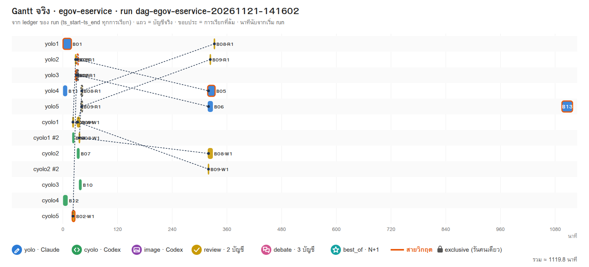
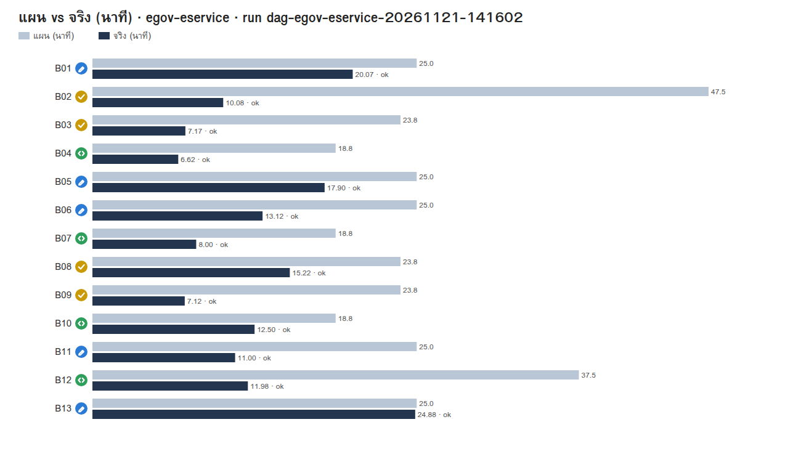

# REPORT · egov-eservice · run dag-egov-eservice-20261121-141602

run directory: `/workspace/.agent-team/dag-egov-eservice-20261121-141602` · เริ่ม 2026-11-21 14:16:02 · simulate: ไม่มี

| บล็อก | สกิล | บัญชีแผน | บัญชีจริง | นาทีแผน | นาทีจริง | การเรียก | input tokens | output tokens | สถานะ |
|---|---|---|---|---|---|---|---|---|---|
| B01 | yolo | yolo1 | yolo1 | 25.0 | 20.07 | 1 | 98 | 117591 | ok |
| B02 | review | W cyolo3 · R yolo3 | cyolo5,yolo3 | 47.5 | 10.08 | 2 | 1695040 | 33823 | ok |
| B03 | review | W cyolo5 · R yolo4 | cyolo1,yolo2 | 23.8 | 7.17 | 2 | 947306 | 22097 | ok |
| B04 | cyolo | cyolo4 | cyolo1 | 18.8 | 6.62 | 1 | 1181753 | 15813 | ok |
| B05 | yolo | yolo5 | yolo2,yolo4 | 25.0 | 17.90 | 2 | 204 | 137860 | ok |
| B06 | yolo | yolo4 | yolo3,yolo5 | 25.0 | 13.12 | 2 | 196 | 94151 | ok |
| B07 | cyolo | cyolo2 | cyolo2 | 18.8 | 8.00 | 1 | 2542634 | 19987 | ok |
| B08 | review | W cyolo3 · R yolo3 | cyolo1,cyolo2,yolo1,yolo4 | 23.8 | 15.22 | 4 | 5858041 | 38879 | ok |
| B09 | review | W cyolo5 · R yolo1 | cyolo1,cyolo2,yolo2,yolo5 | 23.8 | 7.12 | 4 | 3953848 | 42961 | ok |
| B10 | cyolo | cyolo4 | cyolo3 | 18.8 | 12.50 | 1 | 2920563 | 19412 | ok |
| B11 | yolo | yolo2 | yolo4 | 25.0 | 11.00 | 1 | 74 | 79311 | ok |
| B12 | cyolo | cyolo2 | cyolo4 | 37.5 | 11.98 | 1 | 1973912 | 33303 | ok |
| B13 | yolo | yolo3 | yolo5 | 25.0 | 24.88 | 1 | 70 | 23482 | ok |

รวม input 21073739 · output 678670 tokens (จาก ledger.jsonl ของ run)

> **หมายเหตุเรื่องโทเค็น (เขียนเพิ่มด้วยมือ):** ยอดข้างบน**ต่ำกว่าที่ใช้จริง** · run นี้รันต่อ 2 รอบ (ดู PLAN.md หัวข้อ 6.3) และ B13 รอบ resume 1 (เริ่ม 21 พ.ย. 19:51 บัญชี yolo3 · opus/xhigh) ถูกตัดกลางทางเมื่อเครื่อง/Docker รีสตาร์ต process จึงไม่ได้เขียนแถวลง `ledger.jsonl` · โทเค็นของรอบนั้น (ประมาณ 45 นาทีของงานรวม + รัน Playwright) **ไม่อยู่ในตาราง** และกู้กลับไม่ได้ จึงไม่ได้ประมาณตัวเลขใส่ · แถว B13 ในตารางเป็นของรอบ resume 2 (22 พ.ย. 08:30–08:55 บัญชี yolo5) เท่านั้น · การเรียกที่ล้มเพราะโควตาหมด (B05 B06 B08 B09 รอบแรก) อยู่ในตารางแล้ว (คอลัมน์ "การเรียก" นับรวม) · การตรวจความพร้อมบัญชีก่อนแต่ละรอบ (haiku "ตอบ OK") ไม่นับในตารางนี้

## ตัวปรับเวลา k (KC-QUEST ขั้น ⑥ เรียนรู้)

| สกิล | k ที่วัดได้ (จริง ÷ แผนฐาน) | k ใหม่ใน calib.json | บล็อก |
|---|---|---|---|
| yolo | 0.696 | 0.658 | 5 |
| review | 0.333 | 0.288 | 4 |
| cyolo | 0.417 | 0.417 | 4 |

บันทึกที่ `/workspace/plans/calib.json` → `plan` ครั้งถัดไปคูณเวลาด้วย k ของสกิลนั้น
